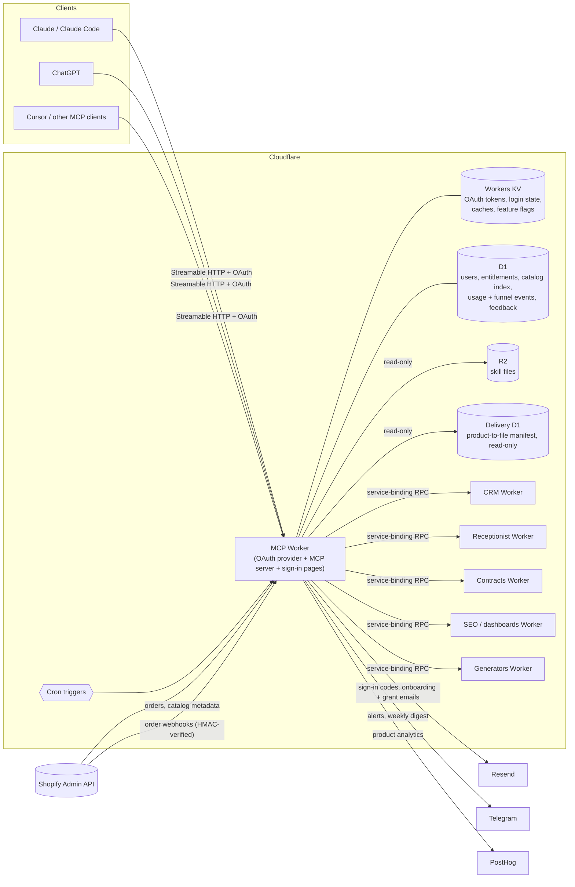

# KissMySkills MCP Connector

**One remote MCP server that turns a store of AI skills into something Claude, ChatGPT and Cursor can actually use — with sign-in, entitlements and product tools built in.**

## The problem

KissMySkills sells ready-made AI skills: personas, prompt packs, agents and bundles. Originally a buyer received a file and had to paste it into a chat by hand. That breaks in three places:

- **Discovery.** With thousands of products, buyers forget what they own, and the assistant never knows the library exists.
- **Access.** Files get copied, go stale, and there is no clean link between "who paid" and "who can use it".
- **Fragmentation.** The brand was also launching its own tools (an AI CRM board, a website receptionist, contract review, SEO checks). Each one needing its own connector would mean more setup and more drop-off.

## Who it's for

- People who bought KissMySkills skills or a subscription and work in Claude, ChatGPT, Claude Code or Cursor.
- Small-business users of the KissMySkills CRM and receptionist products who want to run them by chatting with an assistant.

## Key features

- **One connector, one URL.** A single remote MCP endpoint (Streamable HTTP) exposes the skill catalog plus every KissMySkills product as tool families. Roughly 150 tools at the time of writing (see [docs/tool-surface.md](docs/tool-surface.md)).
- **Skills on demand.** `search_skills`, `suggest_skills` and `get_skill` find a fitting specialist and load it into the conversation. Loaded skills suggest related roles, so one chat can hand off between several specialists.
- **Proactive by design.** Server instructions and MCP prompts (`find-specialist`, `build-team`, `browse-catalog`, ...) tell the assistant to check the catalog before substantial professional work. Each instruction has an explicit "nothing fits, just do it yourself" escape hatch.
- **Standards-based sign-in.** OAuth 2.1 with Protected Resource Metadata and Dynamic Client Registration, so clients connect without manual keys. Users sign in with a one-time email code or Google, then accept the terms and approve access on a consent screen.
- **Entitlements from Shopify orders.** Access is calculated from the user's store orders by email, kept current by order webhooks plus a periodic reconcile job, and can be extended with manual grants.
- **Product tool families over RPC.** CRM, receptionist, contracts, SEO/dashboards and generators each live in their own Worker and publish their own tool lists. The connector loads them at request time.
- **Interactive cards (MCP Apps).** Hosts that support MCP Apps render cards for a loaded skill, the user's plan, search results, the CRM "today" view and SEO reports. Other hosts get plain text.
- **Account controls.** Users can revoke all sessions, delete their account and send feedback or bug reports from the chat.
- **Operations built in.** Owner alerts and a Monday usage digest go to Telegram, transactional email is sent through Resend, and grant emails are localized into 7 languages.

## How it works

**Request path.** The client discovers the authorization server, registers itself and runs the OAuth flow. Each `/mcp` call carries a bearer token. The Worker resolves the user's entitlement (cached briefly in KV) and registers the skill tools. It then registers the product families the user's grant covers and handles the call.

**Catalog.** Product metadata (titles, tags, product lines) syncs from Shopify into D1. The skill text comes from the same R2 objects the delivery service sends to buyers. A daily full sync and an hourly incremental sync keep it current. A product without a mapped file is still listed, with a "syncing soon" note.

**Scheduled jobs.** Order reconcile, catalog sync, data-retention clean-up, lifecycle emails, owner alerts and the Monday usage digest.

The auth and entitlement sequence is in [docs/auth-and-entitlements.md](docs/auth-and-entitlements.md).

## Tech stack

- **Runtime:** Cloudflare Workers (TypeScript), Hono for the HTML/sign-in routes
- **MCP:** `@modelcontextprotocol/sdk` (Streamable HTTP, tools, prompts, MCP Apps resources), tool annotations
- **Auth:** `@cloudflare/workers-oauth-provider` (OAuth 2.1, PKCE, DCR, RFC 9728 metadata), email one-time codes, Google sign-in (OIDC)
- **Data:** D1 (SQLite), Workers KV, R2; service bindings to sibling Workers over RPC
- **Commerce:** Shopify Admin GraphQL API and order webhooks
- **Messaging & analytics:** Resend (email), Telegram Bot API (ops), PostHog and GA4 Measurement Protocol
- **Delivery:** separate staging and production environments, runtime feature flags, `node --test` unit tests, `tsc` type checks

## My role

I owned this end to end as PM and builder, writing the code with Claude Code as my pair. That meant:

- writing the connector spec and splitting it into shippable steps: sign-in first, then order-based access, then the real catalog, then product tool families, then widgets;
- making the product calls: what is free versus paid, what the consent screen promises, which nudges and emails exist, what the assistant should do without being asked;
- running releases through a staging environment and feature flags, with a one-line rollback for every risky change;
- defining the metrics and the weekly digest I use to decide what to build next.

## What I learned / product decisions

- **Proactivity beats waiting for a keyword.** The early connector only fired when users said the word "skill". Server instructions, a `suggest_skills` entry point and MCP prompts moved it to fire on the *shape of the work*. Later I rewrote the tool descriptions in neutral language and moved the guidance into server instructions. Directory review treats pushy tool descriptions as model manipulation.
- **Use the store as the source of truth for access.** Access comes straight from Shopify orders instead of a separate billing system. Webhooks give speed, a periodic reconcile catches missed events, and sign-in fails safe to the free tier when Shopify is unreachable. A sign-in should never be blocked by a commerce outage.
- **Isolate product families.** Each product Worker owns its tool list and plan checks. If one is missing, slow or failing, only that family drops out of the session and the skills tools keep working. This let the CRM and other products ship on their own schedules.
- **Measure demand, not just usage.** Every tool call is logged. The weekly digest reports search-to-load conversion, multi-role conversations and **searches that returned nothing**. That last line is the most actionable: each empty search is demand the catalog could not serve.

Abuse protection and privacy (data retention, account deletion, scoped consent for CRM data) are built in. I've kept those details out of this public summary on purpose.

## Live

- Product: [kissmyskills.com](https://kissmyskills.com) · connector page: [kissmyskills.com/pages/connector](https://kissmyskills.com/pages/connector)
- MCP endpoint (add as a custom connector): `https://mcp.kissmyskills.com/mcp`
- Public Claude Code / Cursor plugin that wraps the connector: [github.com/Kreal-51/kissmyskills-plugin](https://github.com/Kreal-51/kissmyskills-plugin)

---

Source is private; happy to walk through it in an interview.
