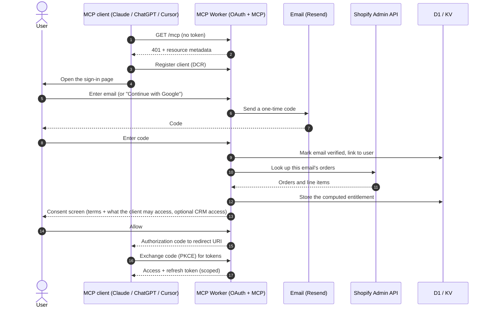
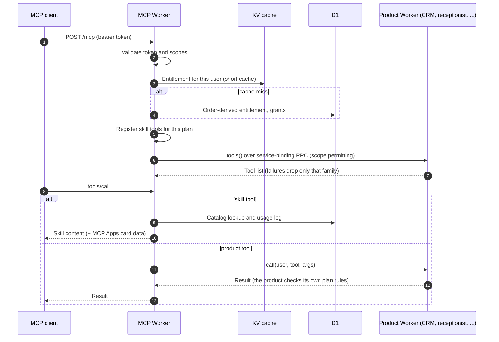
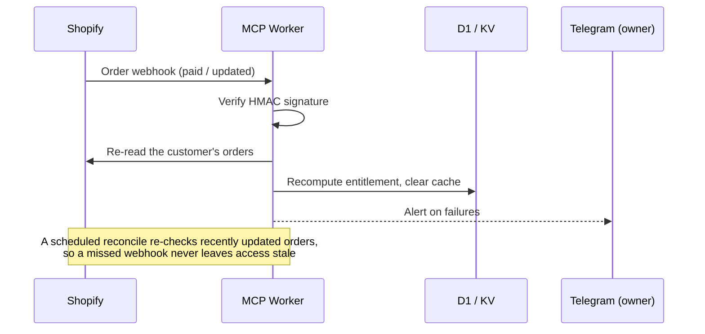

# Sign-in and entitlements (high level)

The connector is its own OAuth 2.1 authorization server, built on the Cloudflare Workers OAuth provider. MCP clients find it through Protected Resource Metadata (RFC 9728) and register themselves with Dynamic Client Registration, so the user never copies an API key. Sign-in uses PKCE.

## Connect and sign in

## Every tool call

## Keeping entitlements fresh

## Notes

- **Fail-safe.** If Shopify cannot be reached during sign-in, the user signs in on the free tier instead of being blocked.
- **Scopes.** Skills access is the default. Access to CRM data is a separate opt-in on the consent screen, because client records are personal data.
- **First-party sites** (the skill builder and the CRM web app) reuse the same sign-in as registered public clients. Their grants are exchanged server-side and revoked right away.
- **User controls.** Users can revoke every session or delete their account from the chat.
- **Abuse protection** applies to the sign-in and catalog paths. Its details are deliberately left out of this document.
